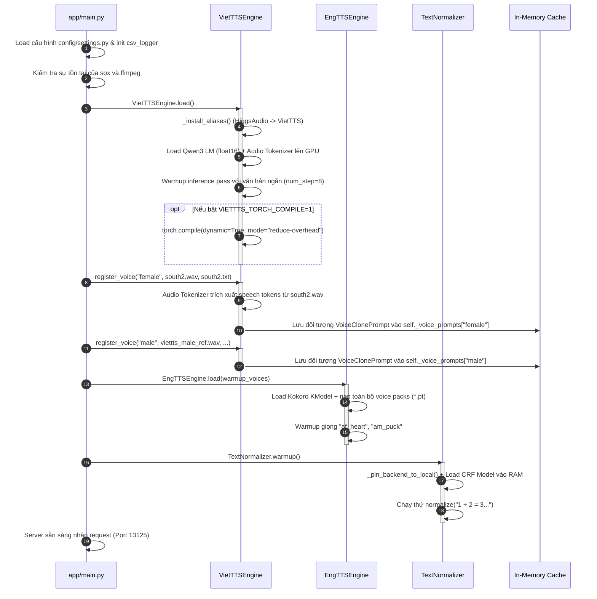
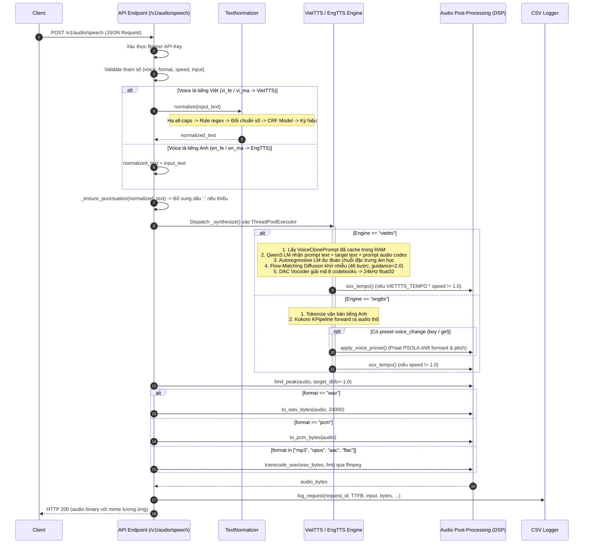

# StreamingTTS — Unified Text-to-Speech Server (OpenAI-Compatible)

Hệ thống dịch vụ chuyển văn bản thành giọng nói (**Text-to-Speech - TTS**) hiệu năng cao, hỗ trợ đa ngôn ngữ (**Tiếng Việt & Tiếng Anh**), tích hợp công nghệ **Zero-Shot Voice Cloning** (sao chép giọng nói tức thì qua Prompt Conditioning), pipeline chuẩn hóa văn bản tiếng Việt nâng cao và hậu xử lý âm thanh kỹ thuật số (DSP).

Cung cấp giao diện lập trình chuẩn OpenAI (`POST /v1/audio/speech`), sẵn sàng tích hợp trực tiếp vào các hệ thống trợ lý ảo, Voicebot và Agent đàm thoại thời gian thực.

---

## MỤC LỤC

1. [Kiến Trúc Hệ Thống & Phân Tầng Các Lớp (Architecture Layers)](#1-kiến-trúc-hệ-thống--phân-tầng-các-lớp-architecture-layers)
2. [Chi Tiết Các Luồng Xử Lý (Execution & Data Flows)](#2-chi-tiết-các-luồng-xử-lý-execution--data-flows)
   * [2.1. Luồng Khởi Động & Nạp Giọng Mẫu (Startup & Voice Ingestion Flow)](#21-luồng-khởi-động--nạp-giọng-mẫu-startup--voice-ingestion-flow)
   * [2.2. Luồng Suy Luận Thời Gian Thực (End-to-End Inference Flow)](#22-luồng-suy-luận-thời-gian-thực-end-to-end-inference-flow)
3. [Các Kỹ Thuật Cốt Lõi Được Sử Dụng (Core Techniques & Algorithms)](#3-các-kỹ-thuật-cốt-lõi-được-sử-dụng-core-techniques--algorithms)
   * [3.1. In-Context Speech Prompt Conditioning (Zero-Shot Voice Cloning)](#31-in-context-speech-prompt-conditioning-zero-shot-voice-cloning)
   * [3.2. Kiến Trúc Hybrid Speech LLM (Qwen3 + DAC + HuBERT + Flow-Matching)](#32-kiến-trúc-hybrid-speech-llm-qwen3--dac--hubert--flow-matching)
   * [3.3. Pipeline Chuẩn Hóa Văn Bản Đa Tầng (Rule-based + Statistical CRF)](#33-pipeline-chuẩn-hóa-văn-bản-đa-tầng-rule-based--statistical-crf)
   * [3.4. Cơ Chế Punctuation Guard (Bảo Vệ Ngắt Câu Tự Hồi Quy)](#34-cơ-chế-punctuation-guard-bảo-vệ-ngắt-câu-tự-hồi-quy)
   * [3.5. Phân Đoạn Văn Bản Dài (Long-Form Chunking) & Thích Ứng Bước Khử Nhiễu](#35-phân-đoạn-văn-bản-dài-long-form-chunking--thích-ứng-bước-khử-nhiễu)
   * [3.6. Xử Lý Tín Hiệu Số Âm Thanh (DSP) & Biến Đổi Giọng (Voice Transformation)](#36-xử-lý-tín-hiệu-số-âm-thanh-dsp--biến-đổi-giọng-voice-transformation)
4. [Đặc Tả Giao Diện API (API Specifications)](#4-đặc-tả-giao-diện-api-api-specifications)
5. [Danh Mục Giọng & Điều Phối (Voice Catalogue & Routing)](#5-danh-mục-giọng--điều-phối-voice-catalogue--routing)
6. [Cấu Hình Hệ Thống (Environment Configuration)](#6-cấu-hình-hệ-thống-environment-configuration)
7. [Hướng Dẫn Triển Khai & Kiểm Thử (Deployment & Testing)](#7-hướng-dẫn-triển-khai--kiểm-thử-deployment--testing)

---

## 1. KIẾN TRÚC HỆ THỐNG & PHÂN TẦNG CÁC LỚP (ARCHITECTURE LAYERS)

Hệ thống được thiết kế theo mô hình phân tầng chặt chẽ (Layered Architecture), tách biệt giữa tầng dịch vụ mạng, tiền xử lý ngôn ngữ, động cơ suy luận học sâu và tầng xử lý tín hiệu âm thanh:

```
┌─────────────────────────────────────────────────────────────────────────┐
│ 1. API & SERVICE TRANSPORT LAYER                                        │
│    FastAPI • Uvicorn • Pydantic • Bearer Auth • CSV Metric Logger       │
└────────────────────────────────────┬────────────────────────────────────┘
                                     │
                                     ▼
┌─────────────────────────────────────────────────────────────────────────┐
│ 2. TEXT NORMALIZATION LAYER                                             │
│    Regex Heuristics • Abbreviation Engine • Time Expansion • CRF Model  │
└────────────────────────────────────┬────────────────────────────────────┘
                                     │
                                     ▼
┌─────────────────────────────────────────────────────────────────────────┐
│ 3. CORE TTS INFERENCE ENGINES                                           │
│    ├─ VietTTSEngine: Qwen3-1.2B LM + HiggsAudioV2 (DAC/HuBERT) + Flow   │
│    └─ EngTTSEngine: Kokoro KModel + Voice Packs Pipeline                │
└────────────────────────────────────┬────────────────────────────────────┘
                                     │
                                     ▼
┌─────────────────────────────────────────────────────────────────────────┐
│ 4. AUDIO POST-PROCESSING & DSP LAYER                                    │
│    SoX Time-Stretch • Praat PSOLA Voice Changer • Soft Peak Limiter     │
└────────────────────────────────────┬────────────────────────────────────┘
                                     │
                                     ▼
┌─────────────────────────────────────────────────────────────────────────┐
│ 5. RESPONSE ENCODING & TRANSCODING LAYER                                │
│    Direct RIFF/WAVE 16-bit • PCM Raw • FFmpeg (MP3, Opus, AAC, FLAC)   │
└─────────────────────────────────────────────────────────────────────────┘
```

### 1.1. Lớp Dịch Vụ & Mạng (API & Service Transport Layer)
* [app/main.py](file:///Users/phuocthanh/streamingtts_13125_code/app/main.py): Khởi tạo FastAPI app, thiết lập endpoint chuẩn OpenAI `POST /v1/audio/speech`, `/voices`, `/health`.
* [app/auth.py](file:///Users/phuocthanh/streamingtts_13125_code/app/auth.py): Chứa hàm [require_api_key](file:///Users/phuocthanh/streamingtts_13125_code/app/auth.py#L9-L16) xác thực `Bearer token` thông qua biến môi trường `TTS_API_KEY`.
* [app/schemas.py](file:///Users/phuocthanh/streamingtts_13125_code/app/schemas.py): Pydantic Schema [SpeechRequest](file:///Users/phuocthanh/streamingtts_13125_code/app/schemas.py#L6-L23) kiểm soát dữ liệu gửi lên (`model`, `input`, `voice`, `response_format`, `speed`).
* [app/csv_logger.py](file:///Users/phuocthanh/streamingtts_13125_code/app/csv_logger.py): Ghi log phi đồng bộ các chỉ số vận hành: `timestamp`, `request_id`, `ttfb_ms`, `input_length`, `input_text`, `normalized_text`, `output_bytes`, `status_code`, `error`.
* **Async Thread Offloading**: Sử dụng `concurrent.futures.ThreadPoolExecutor(max_workers=MAX_WORKERS)` kết hợp `loop.run_in_executor()` để chuyển toàn bộ việc tính toán suy luận GPU và các tiến trình con (subprocess DSP) sang worker thread độc lập, không gây nghẽn (non-blocking) Async Event Loop của FastAPI.

### 1.2. Lớp Tiền Xử Lý & Chuẩn Hóa Văn Bản (Text Normalization Layer)
* [text_normalizer/\_\_init\_\_.py](file:///Users/phuocthanh/streamingtts_13125_code/text_normalizer/__init__.py): Chứa Facade class [TextNormalizer](file:///Users/phuocthanh/streamingtts_13125_code/text_normalizer/__init__.py#L61-L119), quản lý nạp trễ (lazy loading) và ghim đường dẫn mô hình CRF cục bộ qua `_pin_backend_to_local()`.
* [text_normalizer/rules.py](file:///Users/phuocthanh/streamingtts_13125_code/text_normalizer/rules.py): Triển khai các bộ lọc Regex biên dịch trước:
  - [lowercase_all_caps_words](file:///Users/phuocthanh/streamingtts_13125_code/text_normalizer/rules.py#L75-L78): Chuyển chữ hoa sang chữ thường cho các từ viết in hoa nhằm tránh đọc đánh vần.
  - [expand_times](file:///Users/phuocthanh/streamingtts_13125_code/text_normalizer/rules.py#L87-L114): Chuyển biểu thức thời gian `HH:MM[:SS]` sang từ ngữ tiếng Việt tự nhiên kèm buổi trong ngày (`sáng`, `chiều`, `tối`).
  - [swap_us_to_vi_numbers](file:///Users/phuocthanh/streamingtts_13125_code/text_normalizer/rules.py#L143-L155): Phát hiện định dạng số kiểu Mỹ (`1,234.56`) và hoán đổi dấu sang quy ước Việt Nam (`1.234,56`).
  - `PUNCT_DECOUPLE_RE`: Tách dấu câu kết thúc dính liền với từ để tránh tokenizer nuốt dấu câu.
* [text_normalizer/mappings.py](file:///Users/phuocthanh/streamingtts_13125_code/text_normalizer/mappings.py): Từ điển mở rộng từ viết tắt (`ABBREVIATIONS_SRC`), phiên âm cưỡng bức (`PRONUNCIATION_OVERRIDES_SRC`), ký hiệu toán/tiền tệ (`SYMBOL_MAP`).
* **Statistical Machine Learning (CRF)**: Tích hợp `SoeNormalizer` từ gói `soe_vinorm` (chạy trên mô hình CRF - Conditional Random Field tại [models/normalizer/](file:///Users/phuocthanh/streamingtts_13125_code/models/normalizer)) để phân tích và chuẩn hóa từ ngữ phi chuẩn (Non-Standard Words - NSW) như số đếm, số thứ tự, tiền tệ, ngày tháng năm.

### 1.3. Lớp Động Cơ Suy Luận Cốt Lõi (Core TTS Engine Layer)
* [engines/viettts/\_\_init\_\_.py](file:///Users/phuocthanh/streamingtts_13125_code/engines/viettts/__init__.py): Class [VietTTSEngine](file:///Users/phuocthanh/streamingtts_13125_code/engines/viettts/__init__.py#L48-L189) đóng gói backend **OmniVoice** (k2-fsa / Higgs Audio).
  - Tự động alias các class upstream (`OmniVoice` $\rightarrow$ `VietTTS`, `HiggsAudioV2Tokenizer` $\rightarrow$ `VietTTSAudioTokenizer`) qua hàm [_install_aliases()](file:///Users/phuocthanh/streamingtts_13125_code/engines/viettts/__init__.py#L22-L46) để load trực tiếp checkpoint nội bộ.
  - Hỗ trợ Zero-shot In-Context Voice Cloning qua `create_voice_clone_prompt()`.
  - Quản lý phân đoạn sinh văn bản dài (`audio_chunk_duration`, `audio_chunk_threshold`).
  - Tùy chọn tăng tốc đồ thị suy luận `torch.compile(mode="reduce-overhead", dynamic=True)`.
* [engines/engtts/\_\_init\_\_.py](file:///Users/phuocthanh/streamingtts_13125_code/engines/engtts/__init__.py): Class [EngTTSEngine](file:///Users/phuocthanh/streamingtts_13125_code/engines/engtts/__init__.py#L19-L84) đóng gói backend **Kokoro TTS** (`KModel` và `KPipeline`), nạp offline trọng số `.pth` và các voice pack `.pt` (`af_heart`, `am_puck`).

### 1.4. Lớp Hậu Xử Lý Tín Hiệu & DSP (Audio Post-Processing Layer)
* [app/audio_post.py](file:///Users/phuocthanh/streamingtts_13125_code/app/audio_post.py):
  - [sox_tempo()](file:///Users/phuocthanh/streamingtts_13125_code/app/audio_post.py#L40-L61): Sử dụng thuật toán WSOLA của công cụ SoX (`sox tempo -s <factor>`) để co/giãn tốc độ phát mà không làm lệch cao độ (pitch-invariant time stretch).
  - [apply_voice_preset()](file:///Users/phuocthanh/streamingtts_13125_code/app/audio_post.py#L64-L105): Sử dụng thư viện **Praat (Parselmouth)** chạy giải thuật PSOLA ("Change gender...") để dịch chuyển dải Formant (`formant_shift`) và cao độ cơ bản (`pitch_median`, `pitch_range`) cho các preset giọng tiếng Anh (`boy`, `girl`).
  - [limit_peak()](file:///Users/phuocthanh/streamingtts_13125_code/app/audio_post.py#L129-L138): Giới hạn biên độ đỉnh (Peak Limiter ở `-1.0 dBFS`), ngăn chặn hiện tượng clipping khi số hóa thành 16-bit PCM.
  - [to_wav_bytes()](file:///Users/phuocthanh/streamingtts_13125_code/app/audio_post.py#L108-L122): Tự tạo header chuẩn RIFF WAVE 16-bit Mono trực tiếp trong RAM không qua đĩa cứng.
  - [transcode_wav()](file:///Users/phuocthanh/streamingtts_13125_code/app/audio_post.py#L140-L160): Chuyển mã sang `mp3`, `opus`, `aac`, `flac` bằng tiến trình `ffmpeg`.

---

## 2. CHI TIẾT CÁC LUỒNG XỬ LÝ (EXECUTION & DATA FLOWS)

### 2.1. Luồng Khởi Động & Nạp Giọng Mẫu (Startup & Voice Ingestion Flow)



---

### 2.2. Luồng Suy Luận Thời Gian Thực (End-to-End Inference Flow)



---

## 3. CÁC KỸ THUẬT CỐT LÕI ĐƯỢC SỬ DỤNG (CORE TECHNIQUES & ALGORITHMS)

### 3.1. In-Context Speech Prompt Conditioning (Zero-Shot Voice Cloning)
* **Bản chất**: Không sử dụng kỹ thuật fine-tuning mô hình riêng, không dùng LoRA adapter và không dùng vector speaker embedding tĩnh (như d-vector hay ECAPA-TDNN 192 chiều).
* **Nguyên lý In-Context Learning**:
  - Đoạn âm thanh tham chiếu (`ref_audio`) được giải mã thành chuỗi các speech tokens rời rạc thông qua bộ mã hóa âm thanh Neural Codec.
  - Transcript chuẩn (`ref_text`) được chuyển thành chuỗi text tokens.
  - Khi cần tổng hợp câu mới, mô hình kết hợp thành chuỗi context:
    $$\text{Sequence} = [\text{Text}_{\text{ref}}, \text{Text}_{\text{target}}] \quad \oplus \quad [\text{SpeechTokens}_{\text{ref}}]$$
  - Nhờ cơ chế Attention của mô hình ngôn ngữ lớn, mạng tự động gióng hàng (alignment) giữa ngữ nghĩa và âm sắc, tái hiện đồng thời: **Âm sắc (timbre), cao độ (pitch), ngữ điệu ngắt nghỉ (prosody), tốc độ nói và đặc tính không gian phòng thu**.

### 3.2. Kiến Trúc Hybrid Speech LLM (Qwen3 + DAC + HuBERT + Flow-Matching)
Mô hình tiếng Việt [models/viettts/](file:///Users/phuocthanh/streamingtts_13125_code/models/viettts) sở hữu kiến trúc Speech AI hiện đại nhất:
* **Backbone Causal LM (`Qwen3ForCausalLM`)**:
  - 28 lớp Transformer, `hidden_size: 1024`, `intermediate_size: 3072`.
  - 16 Attention Heads, 8 Key-Value Heads (Grouped-Query Attention - GQA) giúp tiết kiệm bộ nhớ KV Cache.
  - Hỗ trợ RoPE với $\theta = 1,000,000$, ngữ cảnh tối đa `40,960 tokens`.
* **Dual-Stream Speech Tokenizer (`HiggsAudioV2Tokenizer`)**:
  - **Semantic Stream (`HuBERT`)**: Hoạt động ở tần số 16 kHz (12 lớp, hidden size 768), trích xuất biểu diễn ngữ nghĩa và âm vị, đảm bảo phát âm chính xác từ vựng tiếng Việt.
  - **Acoustic Stream (`DAC` - Descript Audio Codec)**: Tần số bản địa **24,000 Hz**, 8 codebooks dạng Residual Vector Quantization (RVQ), tỷ số nén giảm mẫu 320 lần (hop length 960).
* **Flow-Matching / Diffusion Decoder**:
  - Bộ giải mã khuếch tán dòng chảy giúp tái tạo ma trận acoustic tokens liên tục từ không gian tiềm ẩn (latent space).
  - Sử dụng `num_step = 46` và `guidance_scale = 2.0` (Classifier-Free Guidance) giúp giọng đọc trong trẻo, tự nhiên, triệt tiêu tiếng rè kim loại của vocoder truyền thống.

### 3.3. Pipeline Chuẩn Hóa Văn Bản Đa Tầng (Rule-based + Statistical CRF)
Xử lý ngôn ngữ tự nhiên tiếng Việt cho TTS là bài toán khó do mật độ xuất hiện dày đặc của từ phi chuẩn (NSW). Pipeline xử lý gồm 8 tầng nghiêm ngặt:
1. **Lowercase All-Caps**: Hạ chữ in hoa toàn phần nhằm loại bỏ nguy cơ đọc đánh vần từng chữ cái.
2. **Pronunciation Overrides**: Khắc phục lỗi phát âm các tên riêng/nhãn hiệu (`Pi` $\rightarrow$ `Pii`).
3. **Abbreviations Expansion**: Mở rộng từ viết tắt hành chính và tiền tệ (`TP.HCM`, `VND`, `USD`, `sđt`, `ĐH`).
4. **Punctuation Decoupling**: Tách rời dấu câu đứng sát chữ cái để tránh tokenizer ghép chung ký tự.
5. **Time Expression Parsing**: Chuyển đổi định dạng `HH:MM[:SS]` sang từ ngữ tiếng Việt kèm buổi.
6. **Minus-Between-Numbers**: Phân tách dấu `-` giữa 2 chữ số thành chữ "trừ" (toán học).
7. **US-to-VI Number Convention**: Heuristic phân biệt dấu phẩy và chấm để chuẩn hóa số kiểu Mỹ (`1,234.5`) về chuẩn Việt (`1.234,5`).
8. **Mô hình CRF (`soe_vinorm`)**: Mô hình trường ngẫu nhiên điều kiện nhận diện thực thể và chuẩn hóa số phức, ngày tháng, đơn vị đo lường.

### 3.4. Cơ Chế Punctuation Guard (Bảo Vệ Ngắt Câu Tự Hồi Quy)
* Mô hình Auto-regressive sinh token tuần tự dựa trên điều kiện dừng câu (`EOS` token). Nếu văn bản đầu vào không có dấu kết thúc (`.`, `!`, `?`), mô hình không xác định được điểm ngắt, dễ sinh ra hiện tượng "hallucination", đọc kéo dài âm đuôi, phát ra tiếng thở hoặc tạp âm rè rác ở cuối file.
* Hàm [_ensure_punctuation()](file:///Users/phuocthanh/streamingtts_13125_code/app/main.py#L128-L133) tự động cưỡng bức thêm dấu `.` ở cuối câu nếu phát hiện thiếu dấu ngắt câu hợp lệ.

### 3.5. Phân Đoạn Văn Bản Dài (Long-Form Chunking) & Thích Ứng Bước Khử Nhiễu
* **Thích ứng bước Diffusion (`Adaptive Steps`)**:
  - Với câu ngắn ($\le 50$ ký tự): Sử dụng `VIETTTS_NUM_STEP = 46` cho chất lượng phát âm và âm sắc cao nhất.
  - Với câu dài ($> 50$ ký tự): Tự động chuyển sang `VIETTTS_NUM_STEP_LONG = 46` (hoặc cấu hình thấp hơn qua biến môi trường) để cân đối thời gian xử lý khi bước LM Forward chiếm ưu thế về tài nguyên.
* **Cắt phân đoạn tự động (Chunking)**:
  - Khi ước tính độ dài âm thanh vượt `audio_chunk_threshold = 15.0s`, hệ thống tự động kích hoạt chế độ cắt thành các phân đoạn `audio_chunk_duration = 10.0s`.
  - Giúp loại bỏ hoàn toàn hiện tượng lệch âm sắc, trôi ngữ điệu (prosody drift) trên các đoạn văn bản dài.

### 3.6. Xử Lý Tín Hiệu Số Âm Thanh (DSP) & Biến Đổi Giọng (Voice Transformation)
* **Co giãn tốc độ đọc (Time-Stretching)**:
  - Thuật toán SoX `tempo -s` phân tích chuỗi sóng theo cửa sổ trượt WSOLA (Waveform Similarity Overlap-Add), điều chỉnh tốc độ nói (`effective_tempo = VIETTTS_TEMPO * speed`) mà không làm thay đổi tần số cơ bản F0.
* **Biến đổi đặc tính giọng (Praat PSOLA)**:
  - Áp dụng giải thuật Pitch-Synchronous Overlap and Add của Praat thông qua thư viện `parselmouth`.
  - Phân tích và dịch chuyển dải tần số Formant ($F_1, F_2, F_3$) mô phỏng sự thay đổi chiều dài đường dẫn thanh quản (vocal tract length), kết hợp nén/giãn dải cao độ F0 để biến giọng người lớn thành giọng trẻ em (`boy`, `girl`).
* **Soft Peak Limiter**:
  - Kiểm tra giá trị biên độ tuyệt đối cực đại $A_{\max} = \max(|x|)$. Nếu $A_{\max} > 10^{-1/20} \approx 0.891$ (tương đương $-1.0\text{ dBFS}$), toàn bộ mẫu âm thanh được chuẩn hóa theo hệ số $k = \frac{0.891}{A_{\max}}$, đảm bảo âm thanh không bao giờ bị méo biên độ (hard clipping) khi chuyển sang 16-bit PCM.

---

## 4. ĐẶC TẢ GIAO DIỆN API (API SPECIFICATIONS)

### 4.1. Tạo Âm Thanh (Speech Synthesis)
* **Endpoint**: `POST /v1/audio/speech`
* **Headers**:
  - `Authorization: Bearer <TTS_API_KEY>`
  - `Content-Type: application/json`
* **Request Body** (JSON):
```json
{
  "model": "VietTTS",
  "input": "Xin chào, tôi là trợ lý ảo được phát triển trên hệ thống StreamingTTS.",
  "voice": "vi_fe",
  "response_format": "wav",
  "speed": 1.0
}
```
* **Tham số chi tiết**:
  - `model` *(string, optional)*: `"VietTTS"` hoặc `"EngTTS"`.
  - `input` *(string, required)*: Đoạn văn bản cần chuyển thành giọng nói.
  - `voice` *(string, required)*: Định danh giọng đọc (`"vi_fe"`, `"vi_ma"`, `"en_fe"`, `"en_ma"`).
  - `response_format` *(string, optional)*: Định dạng trả về (`"wav"` [mặc định], `"pcm"`, `"mp3"`, `"opus"`, `"aac"`, `"flac"`).
  - `speed` *(float, optional)*: Hệ số tốc độ đọc (mặc định `1.0`, dải hợp lệ khuyến nghị: `0.5` - `2.0`).
* **Response**: Nhị phân âm thanh (Audio Binary) kèm header tương ứng (`audio/wav`, `audio/mpeg`, v.v.) và `X-Request-ID`.

### 4.2. Danh Sách Giọng Đọc (List Voices)
* **Endpoint**: `GET /voices`
* **Response**:
```json
{
  "voices": ["vi_fe", "vi_ma", "en_fe", "en_ma"],
  "models": ["VietTTS", "EngTTS"],
  "voices_by_model": {
    "VietTTS": ["vi_fe", "vi_ma"],
    "EngTTS": ["en_fe", "en_ma"]
  },
  "details": { ... }
}
```

### 4.3. Kiểm Tra Trạng Thái Hệ Thống (Health Check)
* **Endpoint**: `GET /health`
* **Response**:
```json
{
  "status": "ok",
  "models": ["VietTTS", "EngTTS"],
  "voices": ["vi_fe", "vi_ma", "en_fe", "en_ma"]
}
```

---

## 5. DANH MỤC GIỌNG & ĐIỀU PHỐI (VOICE CATALOGUE & ROUTING)

Hệ thống định tuyến giọng đọc theo bảng cấu hình trong [config/settings.py: VOICE_MAP](file:///Users/phuocthanh/streamingtts_13125_code/config/settings.py#L58-L63):

| Voice ID | Động Cơ | Giọng Mẫu / Preset Gốc | Kỹ Thuật Tổng Hợp | Tần Số Mẫu | Mô Tả |
| :---: | :---: | :---: | :---: | :---: | :--- |
| **`vi_fe`** | `viettts` | `voices/south2.wav` + `.txt` | In-Context Voice Clone | 24,000 Hz | Giọng nữ miền Nam chuẩn, tự nhiên, biểu cảm |
| **`vi_ma`** | `viettts` | `voices/viettts_male_ref.wav` + `.txt` | In-Context Voice Clone | 24,000 Hz | Giọng nam miền Bắc, trầm ấm, truyền cảm |
| **`en_fe`** | `engtts` | `af_heart` (Kokoro) + Praat `girl` | Kokoro + Formant/Pitch Shift | 24,000 Hz | Giọng nữ/bé gái tiếng Anh |
| **`en_ma`** | `engtts` | `am_puck` (Kokoro) + Praat `boy` | Kokoro + Formant/Pitch Shift | 24,000 Hz | Giọng nam/bé trai tiếng Anh |

---

## 6. CẤU HÌNH HỆ THỐNG (ENVIRONMENT CONFIGURATION)

Tất cả các tham số vận hành có thể điều chỉnh linh hoạt thông qua biến môi trường (Environment Variables) trong [config/settings.py](file:///Users/phuocthanh/streamingtts_13125_code/config/settings.py):

| Biến Môi Trường | Mặc Định | Ý Nghĩa / Tác Vụ |
| :--- | :---: | :--- |
| `TTS_API_KEY` | `ioit2025` | Khóa xác thực Bearer token bảo vệ API |
| `TTS_HOST` | `0.0.0.0` | Địa chỉ mạng lắng nghe của HTTP Server |
| `TTS_PORT` | `13125` | Cổng dịch vụ HTTP |
| `TTS_MAX_WORKERS` | `1` | Số lượng luồng worker tính toán song song trong ThreadPoolExecutor |
| `TTS_OUTPUT_SR` | `24000` | Tần số lấy mẫu đầu ra (Sampling Rate) |
| `TTS_VIETTTS_DEVICE` | `cuda:1` | Thiết bị PyTorch chỉ định nạp mô hình VietTTS (`cuda:0`, `cuda:1`, `cpu`) |
| `TTS_VIETTTS_NUM_STEP` | `46` | Số bước khử nhiễu Diffusion cho văn bản ngắn ($\le 50$ ký tự) |
| `TTS_VIETTTS_NUM_STEP_LONG`| `46` | Số bước khử nhiễu Diffusion cho văn bản dài ($> 50$ ký tự) |
| `TTS_VIETTTS_LONG_THRESHOLD`| `50` | Ngưỡng ký tự phân loại câu ngắn và câu dài |
| `TTS_VIETTTS_AUDIO_CHUNK_DURATION`| `10.0` | Thời lượng mục tiêu (giây) của mỗi phân đoạn sinh âm thanh dài |
| `TTS_VIETTTS_AUDIO_CHUNK_THRESHOLD`| `15.0` | Ngưỡng thời lượng ước tính (giây) để kích hoạt chế độ chunking |
| `TTS_VIETTTS_TEMPO` | `1.1` | Hệ số tốc độ phát mặc định phía server cho VietTTS |
| `TTS_OUTPUT_PEAK_DBFS` | `-1.0` | Ngưỡng biên độ cực đại cho phép của Peak Limiter |
| `TTS_VIETTTS_TORCH_COMPILE`| `0` | Bật JIT compile đồ thị bằng `torch.compile` (`1` = bật, `0` = tắt) |

---

## 7. HƯỚNG DẪN TRIỂN KHAI & KIỂM THỬ (DEPLOYMENT & TESTING)

### 7.1. Yêu Cầu Hệ Thống
* **GPU**: NVIDIA GPU với tối thiểu 8GB VRAM (khuyến nghị 16GB+ VRAM khi chạy đồng thời cả VietTTS và EngTTS).
* **Driver & CUDA**: CUDA Driver tương thích CUDA 12.8.
* **Thư viện hệ thống bắt buộc**:
  ```bash
  apt-get update && apt-get install -y sox libsox-fmt-mp3 ffmpeg espeak-ng portaudio19-dev libltdl7 libmagic1
  ```

### 7.2. Khởi Chạy Bằng Docker
Hệ thống được đóng gói hoàn chỉnh trong [Dockerfile](file:///Users/phuocthanh/streamingtts_13125_code/Dockerfile):

```bash
# Build Docker image
docker build -t streamingtts:v5 .

# Chạy container gắn GPU
docker run -d --name streaming_tts_server \
  --gpus '"device=1"' \
  --network host \
  -e TTS_VIETTTS_DEVICE="cuda:0" \
  -e TTS_API_KEY="ioit2025" \
  -e TTS_PORT="13125" \
  streamingtts:v5
```

### 7.3. Kiểm Thử Hệ Thống (Testing Script)
Sử dụng script kiểm thử tự động có sẵn [test_13125_tts.sh](file:///Users/phuocthanh/streamingtts_13125_code/test_13125_tts.sh):

```bash
# Kiểm thử giọng nữ tiếng Việt (mặc định vi_fe)
BASE_URL="http://localhost:13125" ./test_13125_tts.sh "Chào bạn, đây là thử nghiệm giọng nói tiếng Việt." vi_fe output.wav 1.0

# Kiểm thử giọng nam tiếng Việt (vi_ma)
BASE_URL="http://localhost:13125" ./test_13125_tts.sh "Hôm nay thời tiết rất đẹp." vi_ma output_male.wav 1.0

# Kiểm thử gọi trực tiếp bằng cURL
curl -X POST "http://localhost:13125/v1/audio/speech" \
  -H "Authorization: Bearer ioit2025" \
  -H "Content-Type: application/json" \
  -d '{
    "model": "VietTTS",
    "input": "Hệ thống tổng hợp tiếng nói StreamingTTS hoạt động ổn định.",
    "voice": "vi_fe",
    "response_format": "wav",
    "speed": 1.0
  }' \
  --output test_output.wav
```
